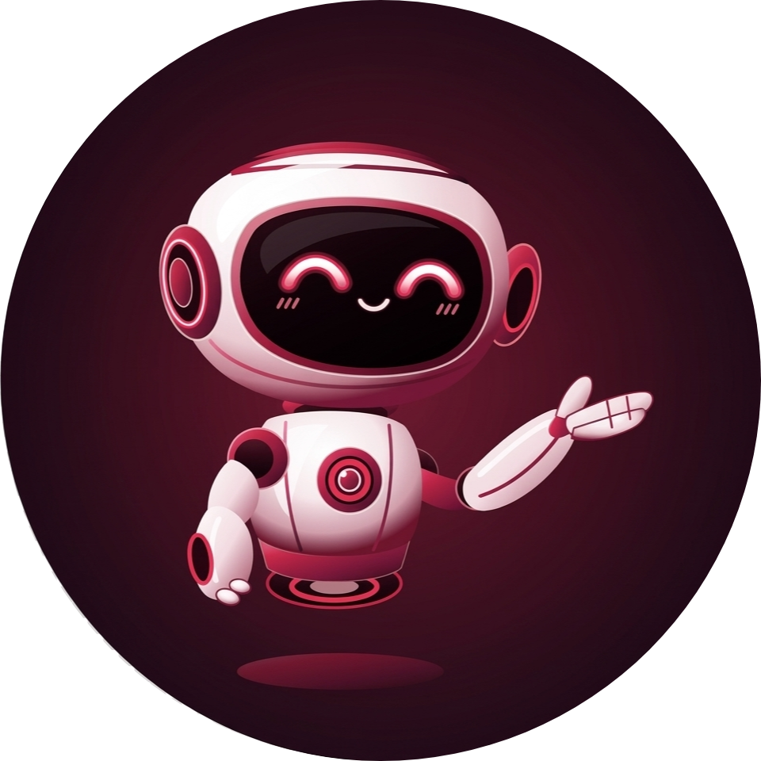

<div align="center">
  
  <h1>karthikeyamudili.github.io</h1>
  <p><b>Interactive student portfolio with a grounded AI recruiter.</b><br/>
  Single-file HTML/CSS/JS · custom SVG visuals · deployed on GitHub Pages.</p>
  <a href="https://karthikeyamudili.github.io"></a>
  <a href="https://github.com/karthikeyamudili"></a>
</div>

---

## What this is

The personal portfolio of **Karthikeya Mudili**, a first-year B.Sc. (Honors) Mathematics
undergraduate (upcoming Computer Science minor) at Dr. Lankapalli Bullayya Degree College,
Visakhapatnam. It presents verified work, research and learning progress in one interactive
page — and lets recruiters *interview the portfolio* through a grounded AI assistant.

This repository is the **website project**. The identity/profile page lives separately in
[`karthikeyamudili/karthikeyamudili`](https://github.com/karthikeyamudili/karthikeyamudili).

## Features

- **Single-file build** — the entire site (markup, styles, scripts, SVG visuals) lives in `index.html`.
- **Grounded AI recruiter** — answers from a fixed, hand-written knowledge base. No live LLM calls, no API keys, no hallucinated claims.
- **Custom SVG / animated visuals** in a burgundy editorial design system.
- **Honest skills section** — levels are explicitly labelled as self-assessed by a first-year student; future interests are labelled as interests, not skills.
- **Evidence-linked work** — every research/project claim links to a real artifact (SSRN, Zenodo, ORCID, live builds).
- **No-backend contact** — the form composes a pre-filled email; nothing is stored or sent to a server.
- **Privacy by default** — no phone number, no trackers, no secrets anywhere in the code.

## Tech stack

| Layer | Choice |
|---|---|
| Markup / styles / logic | HTML5 · CSS3 · vanilla JavaScript |
| Visuals | Hand-authored SVG + CSS animation |
| Hosting | GitHub Pages (auto-deploy from `main`) |
| Dependencies | None — no frameworks, no build step, no backend |

## Project structure

```text
.
├── index.html   # the entire website
├── favicon.png  # robot favicon / mascot
└── README.md    # this file
